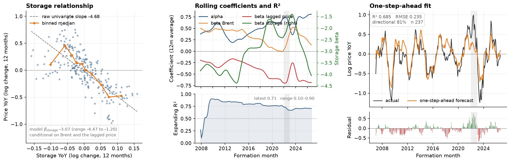

# Forecasting natural gas fundamentals

### A point-in-time fair-value model for NYMEX NG — storage, Brent and UK gas

*Veljko Perovic — commodity analyst. Built 2026.*

**TL;DR.** The model forecasts the natural-gas price twelve months forward from **storage YoY, Brent YoY and the price twelve months ago**. It is a rolling WLS — a 120-month window, 0.985 monthly decay, refitted every month and always one step ahead. The output is a fair-value range (mid, lower, upper) used as one sleeve in the [`natgas`](https://github.com/agrianalystkg/natgas) trading study. The fit is honest rather than spectacular: over the evaluation sample R² ≈ 0.69, expanding R² 0.10–0.90, directional accuracy ≈ 81 %. A second version replaces Brent with UK gas (NBP); the two signals are 0.62 correlated.

This repo is the model's home. It is not a second trading backtest: the trading rule and the book live in [`natgas`](https://github.com/agrianalystkg/natgas).

## Contents

- [What the model does](#what-the-model-does)
- [Data](#data)
- [The model](#the-model)
- [Evidence](#evidence)
- [The FFV range](#the-ffv-range)
- [Brent vs UK gas](#brent-vs-uk-gas)
- [Limitations](#limitations)
- [Reproducing](#reproducing)
- [Data availability](#data-availability)
- [Repository layout](#repository-layout)

## What the model does

For each formation month `F` the model produces a twelve-month price forecast:

```
P_F_hat = P_{F-12} × exp(YoY_hat)
```

where `P_F` is the formation-month price of the NG contract delivering in `F+1` and `YoY_hat` is the fitted log change. One observation is one formation month; the panel is pooled across all months, with no month-of-year dummies.

The two anchors answer the same question with a different external driver:

| Model | External anchor | Question it answers |
|---|---|---|
| Brent | ICE Brent front month and forward curve | What does global crude imply for gas? |
| UK gas | ICE UK NBP front month and forward curve | What does the European gas market imply for gas? |

## Data

### Inputs

| Input | Frequency | Source | Role | Redistributed |
|---|---|---|---|---|
| NYMEX NG futures, per contract | daily | Barchart, own account | formation-month price and target | No |
| ICE Brent front month and forward curve | daily | Barchart/ICE, own account | Brent YoY and forward path | No |
| ICE UK NBP front month and forward curve | daily | Barchart/ICE, own account | UK gas YoY and forward path | No |
| EIA weekly Lower-48 storage | weekly | [EIA](https://www.eia.gov/naturalgas/storage/) | storage level and YoY | Public, shipped |
| NOAA temperatures | daily | [NOAA/NCEI](https://www.ncei.noaa.gov/) | GWDD and storage nowcast | Public, shipped |
| Assembled monthly fundamentals | monthly | built from public EIA monthly series | storage, production, trade and consumption panel | Public, shipped |

The public panels needed to rebuild the model are in `data/`; only the licensed price masters are private.

### Point-in-time rules

Every forecast is built from what was knowable at the run date `d`:

- monthly fundamentals through **M-2**, released on the last business day of month `M`;
- EIA weekly stocks through the **last Thursday ≤ d**;
- weather through the storage nowcast (weekly splice);
- the **current forward curve** for future formation months;
- prices real-time through `d`, so `P_{F-12}` is always known.

The panel is assembled as follows:

1. Per-contract NG settles are collapsed to one price per formation month using a termination-aware window: the average of the last 25 traded days ending five business days before CME termination. A formation month `F` maps to the contract delivering in `F+1`.
2. Storage becomes `log(Storage_F / Storage_{F-12})`.
3. Brent and UK gas become `log(Price_F / Price_{F-12})`.
4. The target is `log P_F − log P_{F-12}`.

EIA storage is used as currently published: later revisions are not reflected in the signal, so there is a small implicit look-ahead. This is discussed under [limitations](#limitations).

## The model

The estimated equation is

$$
\log P_F - \log P_{F-12} = \alpha + \beta_s \cdot \text{StorageYoY}_F + \beta_b \cdot \text{BrentYoY}_F + \beta_l \cdot \log P_{F-12} + \varepsilon_F .
$$

The three regressors have a simple reading:

- **Storage YoY, negative.** More gas in storage than a year ago means a looser balance and a lower price than a year ago.
- **Brent YoY, positive.** Crude is a cost floor and a global demand proxy; gas competes with oil products in power and industry.
- **Lagged log price, negative.** The year-on-year rate mean-reverts; a high price a year ago pulls the current YoY rate down.

The fit is a **rolling WLS**: a 120-month window, exponential weights with monthly decay **0.985** (half-life ≈ 46 months), refitted every month, with a one-step-ahead forecast at each formation month. The window is long on purpose — the model is a slow-moving fundamental relationship, not a trading signal.

The diagnostic sample starts in **2007-01**, the first month with a full 120-month window. The point-in-time FFV history starts earlier, in 2000; in those first years the simulation uses all available history while the window fills. Both facts are visible in the shipped data.

The model is deliberately small: three regressors, no full-sample fit, no per-contract curve fitting, no month-of-year dummies.

## Evidence



*The model is a rolling WLS with three regressors. The left panel shows the raw storage relationship and its binned median; the middle panel shows the monthly coefficients (12-month average) and the expanding R²; the right panel shows the one-step-ahead fit and its residuals. The fit is modest but disciplined, and it is not a full-sample fit — every forecast uses only data available before the formation month.*

| Metric | Value |
|---|---|
| Sample | 2007-01 to 2026-09 |
| Observations | 237 |
| R² | 0.685 |
| RMSE (log YoY) | 0.235 |
| MAE (log YoY) | 0.183 |
| Directional accuracy | 81 % |
| Expanding R² | 0.10–0.90 (latest 0.71) |

The mean residual is −0.05 log points, so the model is slightly optimistic on average. That is small relative to the residual standard deviation of 0.23, but it is the kind of thing worth stating rather than hiding.

Full statistics for both anchors: [`results/model_stats.md`](results/model_stats.md).

### Coefficient stability

| Coefficient | Mean | Range | 2022-12 | 2026-09 |
|---|---:|---:|---:|---:|
| `alpha` | 0.51 | 0.15 to 0.82 | 0.27 | 0.81 |
| `beta_storage` | −3.07 | −4.47 to −1.20 | −1.20 | −4.35 |
| `beta_brent` | 0.33 | −0.02 to 0.56 | 0.55 | 0.07 |
| `beta_lag` | −0.41 | −0.76 to −0.12 | −0.16 | −0.68 |

The 2022 regime is the important story. The Brent beta rose to 0.55 as crude and gas moved together, then collapsed to 0.07; the storage beta moved from −1.20 to −4.35 as the balance reasserted itself. A 120-month window reallocates weight only slowly, which is exactly why the UK gas variant exists.

## The FFV range

The mid is the model forecast. The lower and upper bounds are

```
lower = mid − MAE
upper = mid + MAE
```

where `MAE` is the mean absolute error of the price-level prediction on all history available at the run date, using the current coefficients. The band is not a confidence interval and it is not fixed: it widens when the model has been wrong.

It is a wide band. Across the point-in-time history the average width is about 50 % of the mid, or roughly ±25 %.

Latest Brent snapshot, run date 2026-10-15:

| Contract | Mid | Lower | Upper |
|---|---:|---:|---:|
| NOV/26 | 3.72 | 2.54 | 4.90 |
| DEC/26 | 4.22 | 3.04 | 5.40 |
| JAN/27 | 4.12 | 2.94 | 5.30 |
| FEB/27 | 3.83 | 2.65 | 5.01 |
| MAR/27 | 4.13 | 2.95 | 5.31 |
| APR/27 | 4.77 | 3.59 | 5.95 |

The full 333-month history is in `data/FFV_history_natgas_brent_sim.csv`; the UK gas history is in `data/FFV_history_natgas_ukgas_sim.csv`.

The trading rule that uses the range lives in [`natgas`](https://github.com/agrianalystkg/natgas): the distance from the mid is scaled by half the band width, capped at ±3, with a 28-business-day slope filter for direction. It is not reproduced here.

## Brent vs UK gas

The UK gas variant uses the same target, window, decay and reconstruction, with NBP instead of Brent. It is a second anchor, not an independent edge.

| | Brent | UK gas |
|---|---:|---:|
| Sample | 2007-01 to 2026-09 | 2008-02 to 2026-09 |
| Observations | 237 | 224 |
| R² | 0.685 | 0.723 |
| RMSE | 0.235 | 0.226 |
| Directional accuracy | 81 % | 81 % |
| Expanding R² | 0.10–0.90 | 0.39–0.95 |

In the `natgas` study the two signals are 0.62 correlated monthly. In that study the Brent FFV sleeve lost 33.4 % in 2022; the UK gas sleeve lost 14.3 %. That difference is the reason the second anchor was added.

## Limitations

- The model is regime-dependent. The pooled R² over 2007–2026 is 0.685, but the expanding R² ranges from 0.10 to 0.90.
- The Brent beta is not stable through 2022. The UK gas anchor mitigates this, but it is the same idea with a different driver, not a structural break model.
- EIA storage is used as currently published. Later revisions are not reflected, so there is a small implicit look-ahead.
- The band is wide, and a wide band is not a hedge against a wrong mid.
- The 120-month window and 0.985 decay came from a sensitivity study and sit on a broad plateau.
- The raw data are licensed. The model is reproducible only with your own Barchart/ICE account.
- This is a research output, not investment advice.

## Reproducing

```bash
pip install -r requirements.txt
python forecasting/plot_model_diagnostics.py
```

The chart is regenerated from `data/ffv_brent_model_diagnostics.csv` and needs no raw price data.

The public inputs are shipped: `data/gas_snd_monthly.xlsx` (EIA monthly supply/demand panel, no price columns), `data/eia_weekly_inventory.xlsx`, `data/us_daily_anomaly.parquet` and `data/wx_monthly_exog.parquet`. Only the licensed price masters are private.

To rebuild the model and the diagnostics, put your own `nymex_natgas_master.csv` and `ice_brent_master.csv` under `data/raw/` (or set `NG_PRICES_CSV` and `BRENT_CSV`), then run

```bash
python forecasting/04d_gas_yoy_price_model_brent.py
```

For the UK gas anchor, also put `uk_natural_gas_master.csv` under `data/raw/` or set `UKGAS_CSV`, then run `04e`.

The script writes `data/ffv_brent_model_diagnostics.csv` when `store_coefs=True`, which is the setting used for the main run. The simulations use the same price masters plus the shipped public panels; see [`data/README.md`](data/README.md) for the exact files and columns.

The trading study, the rule and the book are in [`natgas`](https://github.com/agrianalystkg/natgas).

## Data availability

Raw futures and gas price data are downloaded from Barchart/ICE through my own account, subject to their terms, and are not redistributed. Reproducing the model requires your own subscription. EIA storage and NOAA weather data are public. The repo ships derived model diagnostics and point-in-time FFV histories, not the raw price data.

The repo also ships the public EIA monthly supply/demand panel and the NOAA-derived weather files; only the price masters are private.

## Repository layout

```
ng-forecast/
├── forecasting/
│   ├── 04d_gas_yoy_price_model_brent.py
│   ├── 04e_gas_yoy_price_model_ukgas.py
│   ├── 09d_gas_ffv_simulation_brent.py
│   ├── 09e_gas_ffv_simulation_ukgas.py
│   └── plot_model_diagnostics.py
├── data/
│   ├── ffv_brent_model_diagnostics.csv
│   ├── FFV_history_natgas_brent_sim.csv
│   ├── FFV_history_natgas_ukgas_sim.csv
│   ├── gas_snd_monthly.xlsx
│   ├── eia_weekly_inventory.xlsx
│   ├── us_daily_anomaly.parquet
│   ├── wx_monthly_exog.parquet
│   └── README.md
├── images/
│   └── ffv_brent_model.png
├── results/
│   └── model_stats.md
├── requirements.txt
└── .gitignore
```

## Disclaimer

This is a research project. It is not investment advice, and it is not a solicitation to trade. Past performance and fitted relationships do not guarantee future results.
